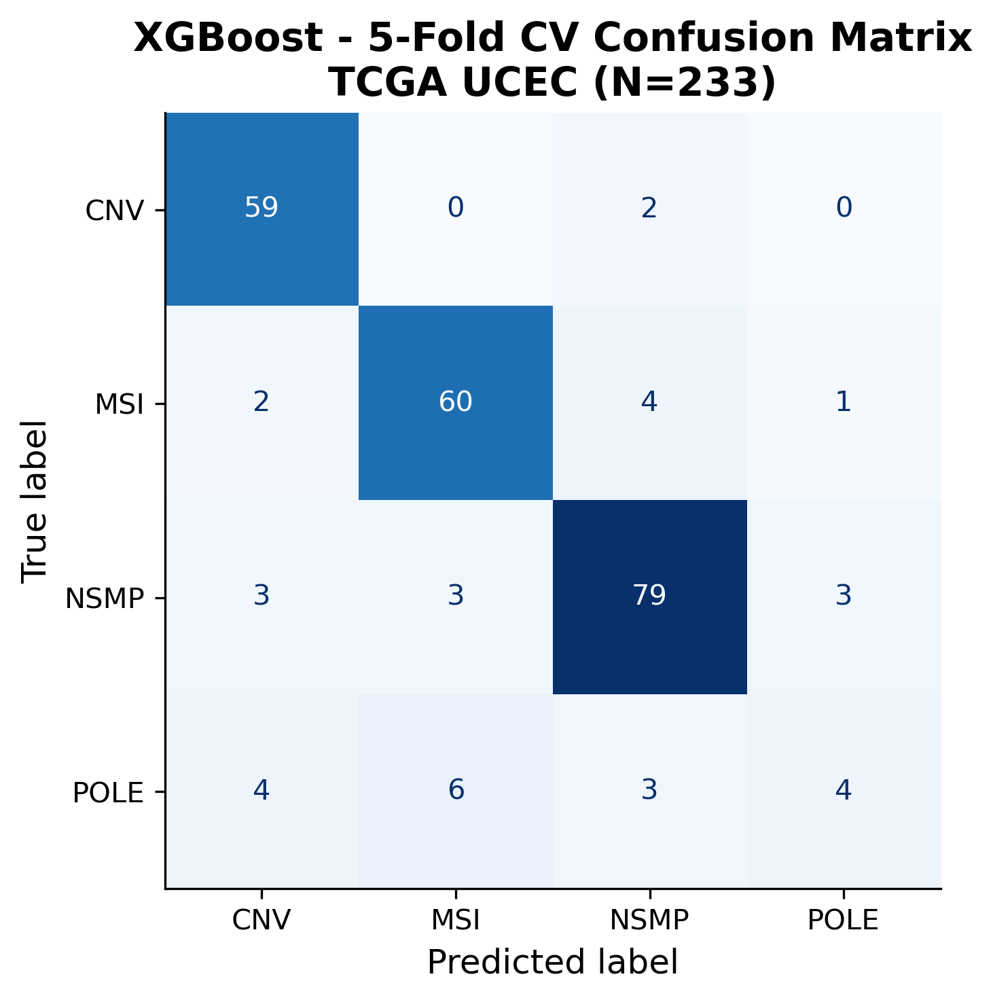
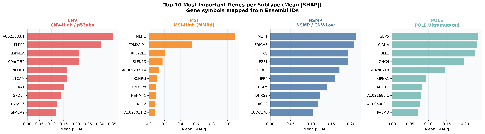

# TCGA-UCEC Molecular Subtype Classification – Interpretable ML Pipeline

An interpretable machine learning pipeline for classifying molecular subtypes of endometrial cancer from TCGA-UCEC RNA-seq data. Built for the Advanced Integrative Omics course.

It combines XGBoost classification, SHAP-based interpretation, and Kaplan–Meier / Cox survival analysis to predict molecular subtype (POLE / MSI / CN-High / NSMP) from expression and to look at which genes drive those predictions.

## Key results

- **Cohort:** 233 TCGA-UCEC patients with molecular subtype labels (NSMP 88, MSI 67, CN-High 61, POLE 17), using the 3,000 most variable genes (log2-TPM).
- **Classification:** class-weighted XGBoost with stratified 5-fold cross-validation reached 0.87 accuracy and a macro ROC-AUC of 0.95 (macro F1 0.75). F1 was 0.91 for CN-High, 0.90 for NSMP and 0.88 for MSI. POLE was the hardest class (F1 0.32): it has only 17 samples and is defined by mutations rather than expression, so expression alone captures it less well.
- **Interpretation:** SHAP rankings included known subtype genes. MLH1 was the top gene for MSI (consistent with MLH1 silencing in mismatch-repair-deficient tumours), the p53 target CDKN1A ranked third for CN-High (behind the lncRNA AC021683.1 and PLPP2), and the interferon-response gene GBP5 ranked highly for POLE. Enrichr analysis of the CN-High SHAP genes returned DNA damage response and the p53 transcriptional network (adjusted p = 0.02–0.03), each based on 3 overlapping genes.
- **SHAP robustness:** recomputing SHAP on held-out samples only (5-fold) recovered 34–39 of each subtype's top-50 genes.
- **Tumour mutation burden:** median TMB was 232.7 mut/Mb for POLE, 13.0 for MSI, 1.5 for CN-High and 1.4 for NSMP, matching the expected subtype pattern.
- **Survival:** overall survival differed only weakly by subtype (log-rank p = 0.07; 21 deaths). Splitting patients at the median of a SHAP-derived score gave log-rank p = 0.037, but in a multivariate Cox model adjusted for grade, stage and subtype the score was not independently associated with survival (HR 1.15, 95% CI 0.84–1.57, p = 0.38). With only 20 events in the Cox model, these survival results are exploratory.





## Methods

- **Data:** RNA-seq counts and TPM, somatic mutations and GDC clinical data downloaded with TCGAbiolinks. Subtype labels, grade, stage and survival come from the TCGA 2013 supplementary subtype table (GDC `tumor_grade` is empty for this cohort). That table's columns are shifted by one; the notebook remaps them in section 2c.
- **Filtering and features:** genes with counts > 0 in at least 20% of samples; log2(TPM + 1); the 3,000 most variable genes as model input.
- **Classification:** XGBoost (300 trees, depth 4) with class weights for imbalance, evaluated with stratified 5-fold cross-validation.
- **SHAP:** per-class mean |SHAP| from a model refit on all 233 samples, used for interpretation only; classification metrics come from cross-validation. A held-out SHAP check (each sample explained by the fold model that did not see it) is included as a robustness test.
- **Enrichment:** Enrichr (gseapy) on the top SHAP genes per subtype, with lncRNAs and pseudogenes removed. Enrichr uses a genome-wide background, so these results are exploratory.
- **TMB:** protein-changing mutations per patient (silent mutations excluded) divided by an assumed 30 Mb exome.
- **Survival:** Kaplan–Meier with log-rank tests; multivariate Cox proportional hazards (lifelines, penalizer 0.1) with grade, stage, subtype and the SHAP-derived score. The score is the mean |SHAP| across all classes and genes for each patient.

## Limitations

- The 3,000 variable genes are chosen using all samples before cross-validation. This step does not use the labels, but it is not repeated inside each fold.
- The SHAP-derived score comes from a model trained on the same patients used in the survival analysis.
- The Cox model has 20 events for 6 covariates (about 3 events per variable), well below the usual guideline of ~10, so its estimates are unstable. Kaplan–Meier uses 21 deaths; 2 patients without stage are dropped from the Cox model.
- POLE has only 17 samples, which limits both classification and survival comparisons for that subtype.

## Repository structure

```
.
├── data/
│   ├── data_download.R              # Pulls raw TCGA-UCEC data via TCGAbiolinks/GDC
│   ├── raw/                         # NOT tracked – regenerate via data_download.R
│   │   ├── TCGA_UCEC_data/          # Final CSVs (RNA-seq, clinical, CNV, mutations)
│   │   └── GDCdata/                 # TCGAbiolinks' own raw download cache
│   └── processed/
│       └── TCGA_UCEC_processed/     # Derived matrices — see "Data" below
├── notebooks/
│   └── main_analysis.ipynb          # Main analysis: QC, PCA, TMB, XGBoost, SHAP, KM, Cox
├── src/
│   └── main.R                       # Standalone MAF sanity-check script (optional)
├── results/
│   ├── figures/                     # All exported plots (QC, PCA, TMB, survival, SHAP)
│   └── shap_results/                # SHAP top-50 gene tables, held-out overlap, raw SHAP array
├── requirements.txt                 # Python dependencies
└── README.md
```

## Setup

```bash
# R packages (for data_download.R and src/main.R)
R -e 'install.packages("data.table"); BiocManager::install(c("TCGAbiolinks","SummarizedExperiment"))'

# Python packages (for the notebook)
pip install -r requirements.txt
```

## Running the pipeline

Run all commands from the project root.

**1. Download the raw data** (RNA-seq, clinical, CNV and mutation data for TCGA-UCEC from GDC; this can take a while and uses several GB of disk):

```bash
Rscript data/data_download.R
```

This populates `data/raw/TCGA_UCEC_data/` (18 CSVs + session info) and `data/raw/GDCdata/` (TCGAbiolinks' download cache).

**2. (Optional) Sanity-check the mutation data:**

```bash
Rscript src/main.R
```

This loads and filters the MAF file and prints it to the console. It is a standalone check and not required before the notebook.

**3. Run the main analysis notebook:**

```bash
jupyter notebook notebooks/main_analysis.ipynb
```

Use **Kernel → Restart & Run All**; later cells depend on variables from earlier ones. The Enrichr step needs internet access. This populates `data/processed/TCGA_UCEC_processed/`, `results/figures/` and `results/shap_results/`.

Or non-interactively:

```bash
jupyter nbconvert --to notebook --execute notebooks/main_analysis.ipynb --output main_analysis.ipynb
```

## Data

**Raw data** (`data/raw/`) is not stored in the repo; regenerate it with `data_download.R` above. TCGA data is public, so this keeps the repo small without losing reproducibility.

**Processed data** (`data/processed/TCGA_UCEC_processed/`): `clinical_aligned.csv`, `pca_coords.csv`, `X_log2tpm_hvg3000.csv` and `y_subtypes.csv` are tracked in the repo. `X_log2tpm_filtered.csv` (the full filtered log2-TPM matrix, ~135 MB) exceeds GitHub's 100 MB file limit and is excluded; the notebook regenerates it from the raw counts.

## Notes

- `MANIFEST.txt` at the project root is written automatically by TCGAbiolinks on every `GDCquery()` call and can't be redirected, so it is gitignored in place.